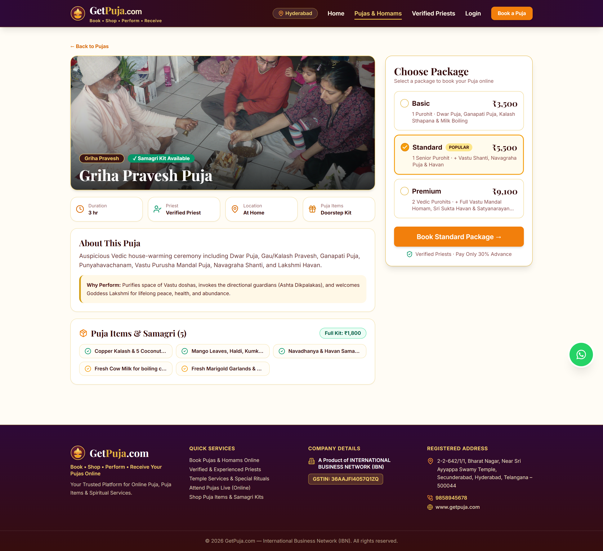
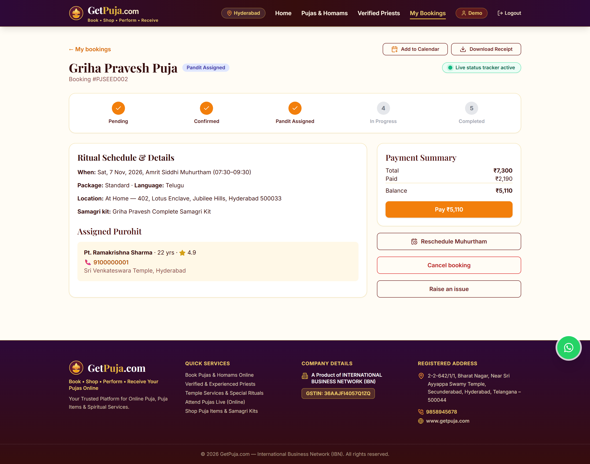

# Puja Platform — User Website Screenshots (`website/screenshots/`)

Desktop viewport previews (`1440×900` @ 2x DPI) captured automatically via [capture-screenshots.js](../../backend/scripts/capture-screenshots.js).

| # | File | Route | Description |
| :--- | :--- | :--- | :--- |
| 01 | [`01-home-page.png`](./01-home-page.png) | `/` | Landing hero banner, Vedic trust badges, featured rituals catalog, and 3-step booking guide in the sacred saffron/maroon/gold aesthetic |
| 02 | [`02-puja-catalog.png`](./02-puja-catalog.png) | `/pujas` | Multi-filter Puja & Ritual catalog (category, location type, spoken language, max price, duration, and samagri kit inclusion) |
| 03 | [`03-puja-detail.png`](./03-puja-detail.png) | `/pujas/:id` | Detailed ritual breakdown, spiritual significance, complete Puja Samagri checklist (`In Kit` vs `Self-arranged`), and package tiers |
| 04 | [`04-pandits-list.png`](./04-pandits-list.png) | `/purohits` | Verified Vedic Purohits directory with specialization, spoken language, city, and rating/experience filters |
| 05 | [`05-pandit-detail.png`](./05-pandit-detail.png) | `/purohits/:id` | Purohit profile page with KYC Verified Acharya badge, Vedic lineage bio, 14-day availability calendar, and devotee reviews |
| 06 | [`06-booking-flow.png`](./06-booking-flow.png) | `/book/:pujaId` | 5-step interactive booking wizard (Package → Date & Auspicious Muhurtham → Location & Samagri Kit → Purohit Selection → Review & Razorpay Checkout) |
| 07 | [`07-my-bookings.png`](./07-my-bookings.png) | `/bookings/:id` | Customer booking dashboard with live Socket.io 5-stage progress tracker, receipt download, Muhurtham reschedule dialog, and assigned Purohit contact card |

---

## Visual Preview Index

### 1. Home / Landing Page (`01-home-page.png`)

### 2. Puja & Ritual Catalog (`02-puja-catalog.png`)

### 3. Puja Detail & Samagri Checklist (`03-puja-detail.png`)

### 4. Verified Vedic Purohits Directory (`04-pandits-list.png`)

### 5. Purohit Profile & 14-Day Availability Calendar (`05-pandit-detail.png`)

### 6. Multi-Step Booking & Muhurtham Flow (`06-booking-flow.png`)

### 7. Customer Bookings & Live Status Tracker (`07-my-bookings.png`)

